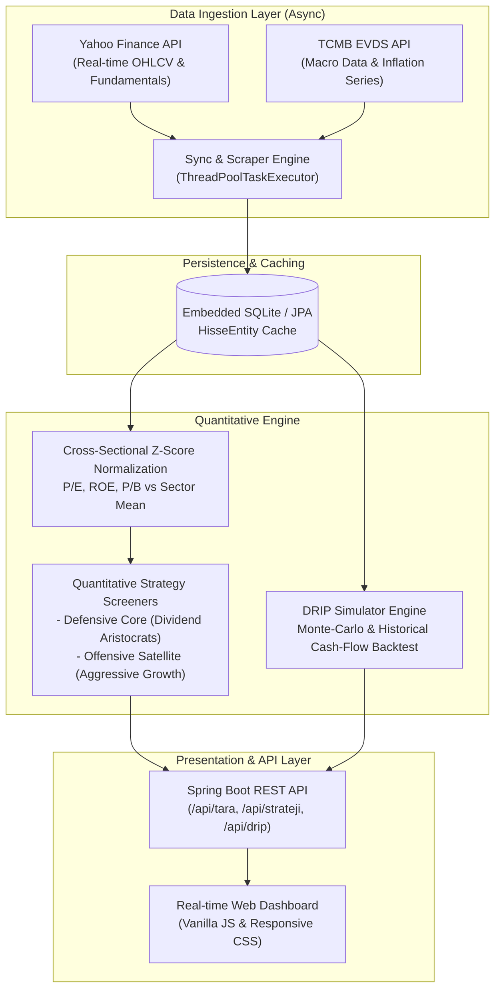

# 📈 BIST Quantitative Analytics & Market Data Pipeline

An end-to-end quantitative financial analytics and automated data ingestion pipeline for Borsa Istanbul (BIST) equities. The platform ingests real-time and historical equity fundamentals, macro statistics, and pricing data to dynamically compute statistical cross-sectional metrics, sectoral Z-scores, momentum signals, and long-term Dividend Reinvestment (DRIP) backtests.

---

## 🏛️ System Architecture



---

## ⚡ Core Features & Quantitative Modules

### 1. Market Data Pipeline & Multi-Source Synchronization
- **Asynchronous Data Fetcher (`SyncService`):** Parallel worker threads pulling daily snapshots and company fundamentals for 500+ BIST tickers without blocking the application thread.
- **TCMB EVDS Macro Integration (`TcmbEvdsClient`):** Dynamically fetches macroeconomic variables (CPI inflation, policy rates) to compute real inflation-adjusted returns and discount rates.
- **Fail-Safe Ingestion:** Rate-limiting handling, automatic backoff, and local SQLite cache persistence for offline quantitative modeling.

### 2. Cross-Sectional Statistical Scoring & Z-Score Normalization
Raw valuation ratios (P/E, P/B, EV/EBITDA) suffer from severe sectoral skew (e.g., Tech vs. Banking). The analytics engine calculates per-sector distributions dynamically:
$$\mu_{\text{sector}} = \frac{1}{N} \sum_{i=1}^{N} X_i, \quad \sigma_{\text{sector}} = \sqrt{\frac{1}{N} \sum_{i=1}^{N} (X_i - \mu_{\text{sector}})^2}$$

$$Z_{\text{Metric}} = \frac{X_i - \mu_{\text{sector}}}{\sigma_{\text{sector}}}$$

- Normalizes valuation metrics across industry clusters.
- Filters out statistical outliers and unprofitable anomalies.

### 3. Quantitative Screening Strategies
- **Defensive Dividend Aristocrats (Core Strategy):**
  - Dividend Yield $> 5\%$ with payout ratio bounded between $[40\%, 85\%]$.
  - Return on Equity (ROE) $> 15\%$ with negative $Z_{\text{P/E}}$ (undervalued relative to sector peers).
  - 5-year dividend consistency check ($4/5$ years minimum dividend payout).
  - Minimum daily trading liquidity filter to prevent microcap slippage.
- **Aggressive Growth (Satellite Strategy):**
  - Targets high-growth sectors (Technology, Telecommunications, Renewable Energy).
  - Strict sector exclusions (Financials, Real Estate, Heavy Industrials).
  - Positive net margins, R&D intensity relative to revenue, and revenue CAGR filters.

### 4. DRIP (Dividend Reinvestment Plan) Simulation Engine
- Simulates realistic multi-year compounding returns assuming full dividend reinvestment at prevailing ex-date market prices.
- Supports monthly capital contributions, dynamic dividend yield shifts, and tax-drag modeling.

---

## 🚀 Tech Stack

- **Backend:** Java 17, Spring Boot 3, Spring Data JPA / Hibernate
- **Database:** SQLite (embedded zero-configuration local datastore)
- **Networking & Clients:** Apache HttpClient, Jackson JSON, Spring Web
- **Frontend:** HTML5, CSS3, ES6 JavaScript
- **Build System:** Apache Maven

---

## 🛠️ API Reference

### Market Screener & Scanning
- `POST /api/tara` — Initiates an asynchronous full-market scan; returns a `sessionId`.
- `GET /api/tara/{id}` — Polls the progress and real-time computation status of the active session.

### Quantitative Strategy Endpoints
- `GET /api/strateji/temettu-devleri` — Returns stocks passing the defensive core dividend criteria with computed Z-scores.
  - Parameters: `minYield`, `minRoe`, `minHacim`, `maxFk`
- `GET /api/strateji/agresif-buyume` — Returns growth-oriented equities screened against profitability and sector constraints.

### Backtesting & Synchronization
- `POST /api/drip` — Executes dividend reinvestment compounding simulation.
  - Payload: `{ "sessionId": "...", "sembol": "THYAO", "sermaye": 100000.0, "aylikEkGirdi": 5000.0 }`
- `POST /api/sync` — Triggers a manual sync against Yahoo Finance and TCMB EVDS.
- `GET /api/sync/status` — Returns synchronization progress and latest inflation rate.

---

## 💻 Quickstart

### Prerequisites
- JDK 17 or higher
- Maven 3.8+

### Build & Run
```bash
# Clone the repository
git clone https://github.com/EmreAlgurr/Bist-Analiz.git
cd Bist-Analiz

# Build package
mvn clean package -DskipTests

# Run Spring Boot application
java -jar target/bist-analiz-1.0.0.jar
```

The web dashboard will be accessible at `http://localhost:8080`.
